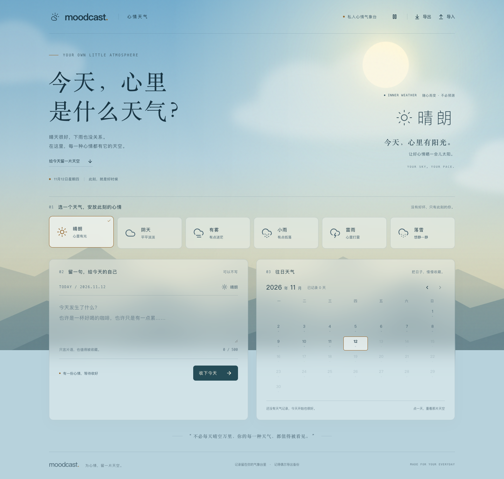

# Moodcast · 心情天气

选一片天空，留一句心情，把日子慢慢收藏。

React + TypeScript + Vite 前端，Rust / Axum 后端，SQLx / SQLite 持久化。Rust 服务同时提供 API 和构建后的前端页面。



[查看雷雨天气效果](docs/storm.png)

## 第一版功能

- 六种全屏心情天气：晴朗、阴天、有雾、小雨、雷雨、落雪。切换天气时整个天空渐变，文字、按钮和半透明面板同步切换明暗。
- 晴天有日光与缓慢漂移的云；阴天整页压暗；雨天有全屏雨幕；雷雨有深色云层、斜雨和间歇闪电；雾天有流动雾层；雪天有冷色天空与飘雪。
- 每天一条记录，可留白、补记过去的日子、修改和删除，最多 500 个 Unicode 字符。
- 按月回看，点击日期恢复那天的天空和文字；不自动写入示例记录。
- JSON 备份导入、导出；导入先完整校验，再通过事务合并，同日期覆盖。
- 手机布局、动效暂停、系统减少动态效果支持，以及未保存内容离开提醒。暂停动效仍保留天气的明暗和静态雨雪。
- SQLite WAL、自动数据库迁移、错误反馈。

## 环境

- Rust 1.85 或更新版本。
- Node.js 18.16+（推荐 22 LTS）、npm。

项目包含依赖锁文件，使用 `--locked` / `npm ci` 保持版本一致。

## 开发

首次安装：

```sh
cd web
npm ci
cd ..
```

启动前后端：

```sh
bash scripts/dev.sh
```

打开 <http://127.0.0.1:5173>。Vite 把 `/api` 代理到 Rust 的 `127.0.0.1:3000`；退出开发脚本会关闭它启动的 Rust 进程。

也可以分别在两个终端运行 `cargo run --locked` 和 `cd web && npm run dev`。

## 单服务运行

```sh
cd web
npm ci
npm run build
cd ..
cargo run --release --locked
```

打开 <http://127.0.0.1:3000>。数据库默认保存在项目的 `data/moodcast.db`，重启服务仍保留记录。

可配置的环境变量：

| 变量 | 默认值 | 说明 |
| --- | --- | --- |
| `MOODCAST_BIND` | `127.0.0.1:3000` | HTTP 监听地址 |
| `DATABASE_URL` | 项目内 `data/moodcast.db` 的 SQLite URL | 自定义文件请先创建父目录 |
| `WEB_DIST` | 项目内 `web/dist` | 前端静态文件路径 |

运行编译好的二进制时，建议显式设置 `WEB_DIST` 和 `DATABASE_URL`，默认路径基于编译时的项目位置。

## Docker

```sh
docker build -t moodcast .
docker run --name moodcast -p 127.0.0.1:3000:3000 -v moodcast-data:/app/data moodcast
```

整个 `/app/data` 目录需要持久化，包含数据库及 WAL 文件。运行中的备份请优先使用页面导出；拷贝数据库文件应在服务关闭后进行。

当前是单人版：所有访问这个服务的人共享同一份记录，没有账号和身份认证。默认仅本机访问；公网使用前需增加登录或在反向代理配置访问认证。跨设备查看需要让设备访问同一个服务。

## 验证

```sh
cargo test --workspace --locked
cargo fmt --all -- --check
cd web
npm run build
```

接口集成测试覆盖新增、更新、按月隔离、删除、导出再导入，以及无效输入和无效备份不产生部分写入。

## API

| 方法 | 路径 | 用途 |
| --- | --- | --- |
| GET | `/api/health` | 服务状态 |
| GET | `/api/records?month=2026-11` | 查询整月记录 |
| PUT | `/api/records/2026-11-12` | 新增或更新，JSON 为 `{ "weather": "rain", "note": "今天有雨。" }` |
| DELETE | `/api/records/2026-11-12` | 删除当天记录 |
| GET | `/api/export` | 导出全部记录 |
| POST | `/api/import` | 导入版本 1 的备份 JSON，最多 5 MB / 10000 条 |

`weather` 可选 `sunny`、`cloudy`、`fog`、`rain`、`storm`、`snow`。日期使用浏览器当地的日历日期，创建和修改时间使用 UTC。

## 目录

```text
server/src/            Rust HTTP 服务和接口测试
server/migrations/     SQLite 迁移
web/src/               页面、天气场景和交互
scripts/dev.sh         本地开发启动脚本
data/                  本地数据（Git 忽略）
```
